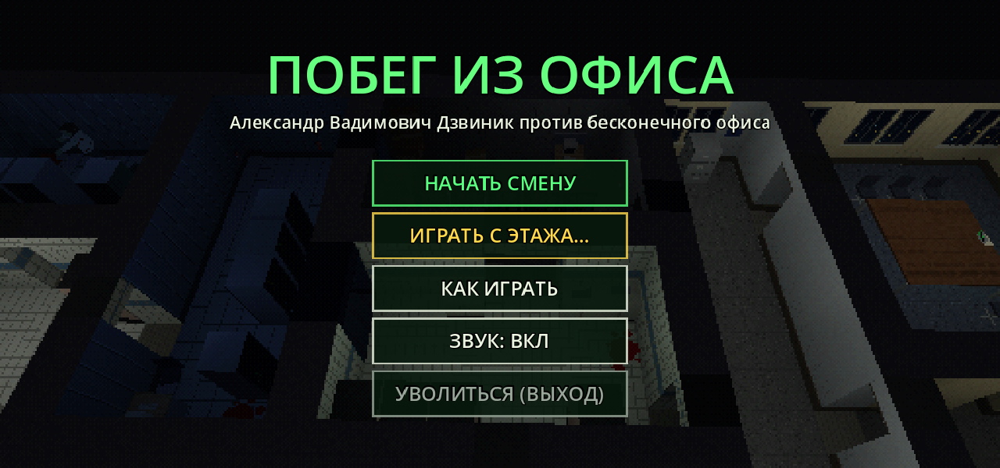
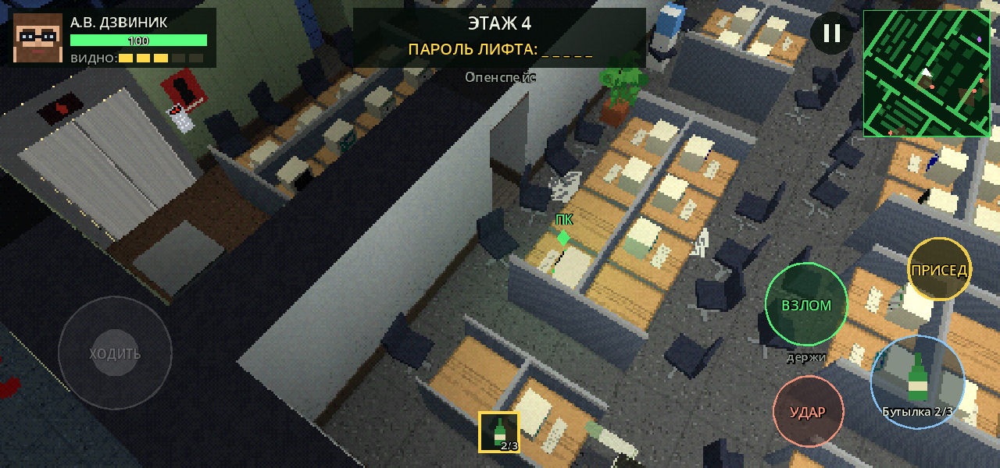
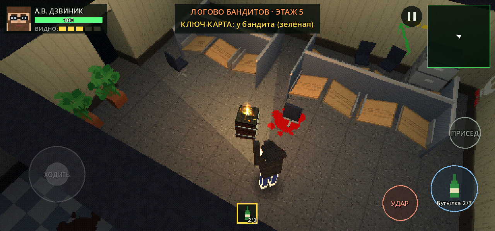
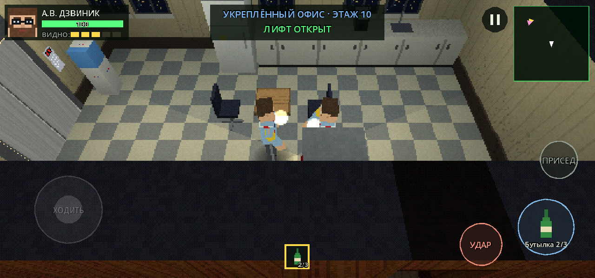
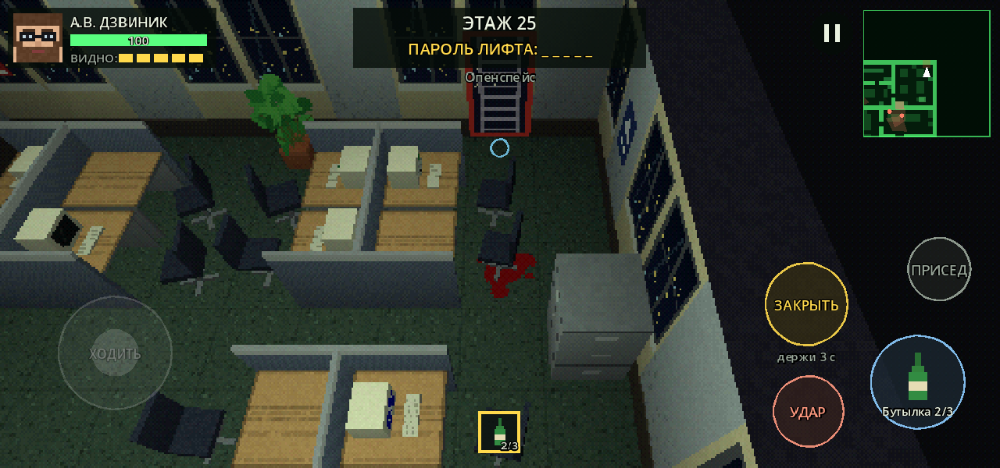
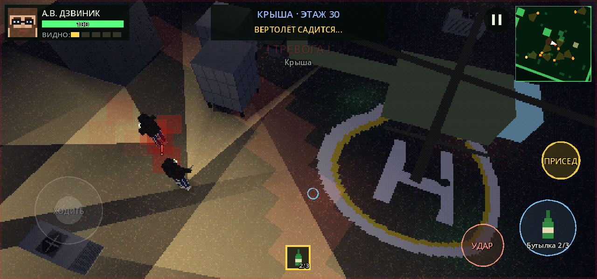

# Побег из офиса

**Стелс-экшен для Android в стиле PlayStation 1.** Айтишник Александр Вадимович Дзвиник застрял в бесконечном офисе,
полном зомби-сотрудников, мародёров и выживших. Тридцать этажей, на каждом — взломать пять компьютеров, собрать пароль
от лифта и уехать выше. На крыше ждёт вертолёт.

<p align="center">
  
  
</p>

## Скачать

Готовый APK — на странице [**Releases**](../../releases/latest). Для Android (arm64 / armv7), экран — горизонтальный.

## Об игре

- **Каждый забег — новый.** Этажи генерируются случайно: опенспейсы, переговорные, кабинеты, серверные, склады.
  С каждым этажом офис больше и опаснее.
- **Стелс, а не бойня.** Крадись вприсядку, прячься за столами, перелезай через перегородки, отвлекай бутылкой,
  души со спины. Враги видят по-разному: зомби — глазами, мародёры — только лучом фонаря. Свидетель побежит за своими.
- **Три стороны.** Офисные зомби (обычные, быстрые бухгалтерши, толстяки, слепые щелкуны на звук), мародёры,
  которые сами зачищают этаж, и выжившие офисники — они за тебя, пока ты их не тронешь. А друг с другом воюют все.
- **Награда за каждый взлом** — пистолет, дробовик, кирпич, граната, кофе… Слоты ограничены: решай, что носить.
- **Особые этажи.** Логово бандитов с ключ-картой на чьей-то спине, укреплённый офис выживших, поле битвы двух
  сторон. С 20-го этажа бандиты лезут с пожарных лестниц — люк можно заколотить.
- **Финал на крыше** — 30-й этаж, вертолёт и его охрана.
- **Настоящий PS1-вид:** низкое разрешение, «плавающие» текстуры без фильтрации, дрожащие вершины, 15-битный цвет.
  Вся графика и весь звук рисуются и синтезируются кодом — в проекте нет ни одного внешнего ассета.

<p align="center">
  
  
</p>
<p align="center">
  
  
</p>

## Управление

| | |
|---|---|
| **Стик слева** | ходьба; слабо наклонил — шаг, сильно — бег (шумно) |
| **ПРИСЕД** | присесть / встать — тише и незаметнее |
| **УДАР** | кулак или холодное; со спины — **ДУШИТЬ** (держи — насмерть) |
| **Большая кнопка** | использовать выбранный предмет: выстрел, бросок, лечение |
| **Тап по врагу** | захватить цель (даже за стеной); **СНЯТЬ ЦЕЛЬ** — отпустить |
| **ВЗЛОМ / ЛИФТ** | держать у компьютера / у лифта |
| **ПЕРЕЛЕЗТЬ, ЗАМЕНИТЬ, ЗАКРЫТЬ** | появляются, когда нужны |
| **Радар** | тап — повернуть камеру |

## Сборка из исходников

Движок — **Godot 4.3**, весь код на GDScript (`godot/` — открыть в редакторе).

Сборка APK под Windows — скрипт `build_apk.ps1`: при первом запуске с ключом `-Download` он скачает Godot 4.3,
шаблоны экспорта, JDK 17 и Android SDK (около 1,4 ГБ), создаст свой ключ подписи и соберёт игру.

```
powershell -ExecutionPolicy Bypass -File build_apk.ps1 -Download
```

Перед сборкой скрипт прогоняет автотест предметов (`--itemtest`). Другие проверки — в `godot/scripts/tests/`:
поединки (`--balancetest`), жизнь этажа без игрока (`--aitest`), нагрузка (`--perftest 12`), автопилот-бот
(`--autotest --smart`).

История изменений — в [CHANGELOG.md](CHANGELOG.md).

## Лицензия

© 2026 ivanstepa2-ui. Все права защищены — см. [LICENSE](LICENSE).
